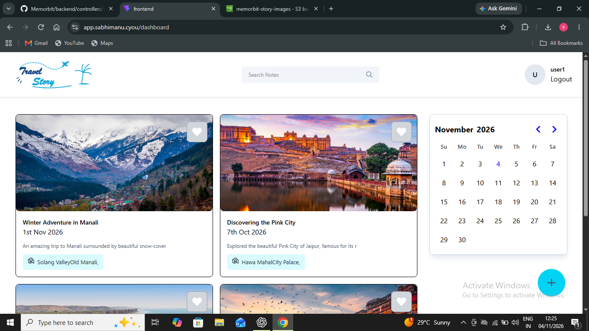
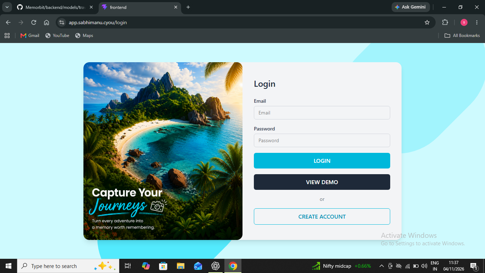
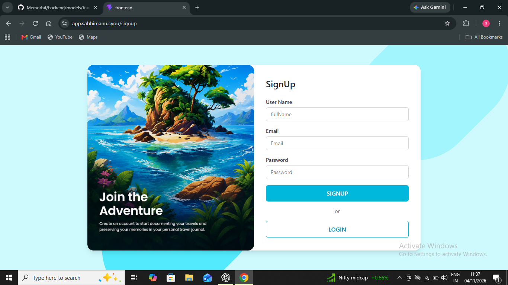
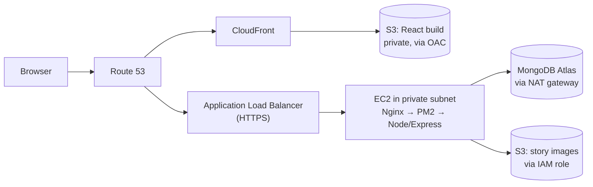

# Memorbit: Travel Story App

A full-stack MERN app where users write travel stories and attach photos, deployed on AWS with a production-style architecture (private subnets, load balancer, CDN, least-privilege IAM, monitoring).

**Live demo:** [app.sabhimanu.cyou](https://app.sabhimanu.cyou) (click **View Demo** on the login page)
**API:** `https://api.sabhimanu.cyou`



<p align="center">
  
  
</p>

---

## Features

- Sign up and log in with JWT authentication (token kept in a cookie, with secure cookie settings in production)
- Passwords hashed with bcrypt
- Create, edit and delete travel stories with title, story, visited locations and visited date
- Upload an image for each story, stored in a **private S3 bucket**
- Images shown through **time-limited signed URLs**, with a default image fallback
- Mark stories as favourites
- Search stories from the dashboard
- Filter stories by date using the calendar
- **View Demo** button on the login page, so anyone can try the app without signing up
- Toast notifications and a responsive UI

---

## Tech Stack

| Area | Technology |
|---|---|
| Frontend | React 19, Vite, Tailwind CSS 4, React Router 7, Axios, React Toastify |
| Backend | Node.js, Express 5, Mongoose 9, Multer, JSON Web Token, bcryptjs |
| Database | MongoDB Atlas |
| File storage | Amazon S3 (private bucket, signed URLs) |
| Cloud | VPC, EC2, Auto Scaling, ALB, ACM, CloudFront, Route 53, IAM, SSM, CloudWatch, SNS |
| Server | Ubuntu, Nginx (reverse proxy), PM2 |

---

## Architecture



**Frontend:** the React build is stored in a private S3 bucket and served through CloudFront using Origin Access Control (OAC). CloudFront caches files at edge locations, and custom error responses make React Router work on page refresh.

**Backend:** Express runs on EC2 in a private subnet with no public IP. Traffic reaches it only through the Application Load Balancer, which terminates HTTPS and redirects HTTP to HTTPS. Nginx proxies requests to the Node app, and PM2 keeps it running and restarts it after crashes or reboots.

---

## AWS Deployment Highlights

- **Network:** custom VPC in `ap-south-1` (Mumbai) with 2 public and 2 private subnets across 2 Availability Zones, an internet gateway, a NAT gateway and separate route tables
- **Security groups:** the server accepts port 80 only from the load balancer's security group. No SSH port is open.
- **Access:** servers are managed through **SSM Session Manager** instead of SSH keys
- **IAM:** an instance role with least-privilege policies (the images bucket and one Parameter Store path only), so **no AWS access keys are stored on the server**
- **Secrets:** stored in **SSM Parameter Store (SecureString)** and loaded at startup, not kept in `.env` files on the server
- **HTTPS:** certificates issued by ACM with DNS validation (one in Mumbai for the ALB, one in `us-east-1` for CloudFront)
- **Auto Scaling:** an Auto Scaling Group with a launch template (1 to 2 instances, 70% CPU target) with ALB health checks
- **Monitoring:** Nginx and application logs shipped to CloudWatch Logs (14-day retention). CloudWatch alarms (unhealthy target, high CPU) send email alerts through SNS, tested by stopping Nginx.
- **Database access:** the MongoDB Atlas network allowlist is limited to the NAT gateway's IP

---

## Project Structure

```
Memorbit/
├── backend/
│   ├── assets/
│   ├── configs/          # Multer / S3 configuration
│   ├── controllers/      # user and travel story controllers
│   ├── models/
│   ├── routes/           # user.route.js, story.route.js
│   ├── default-travel-story.js
│   ├── utilities.js      # JWT authenticateToken middleware
│   └── index.js
├── frontend/
│   ├── public/
│   └── src/
│       ├── assets/
│       ├── componet/        # reusable UI components
│       ├── context/
│       ├── pages/           # home, auth (Login, SignUp)
│       ├── protectedRoute/  # PrivateRoute, PublicRoute
│       ├── utils/           # axios instance and helpers
│       ├── App.jsx
│       ├── StoryModal.jsx   # add / edit story modal
│       └── main.jsx
└── docs/
    └── screenshots/
```

---

## Run Locally

**Requirements:** Node.js 22, a MongoDB Atlas (or local MongoDB) database, and an AWS account with an S3 bucket.

```bash
git clone https://github.com/sabhi-manu/Memorbit.git
cd Memorbit
```

### 1. Backend

```bash
cd backend
npm install
```

Create `backend/.env` (see `.env.example`):

```dotenv
PORT=3000
CLIENT_URL=http://localhost:5173
MONGO_DB_URL=your_mongodb_connection_string
ACCESS_TOKEN_SECRET=your_long_random_secret

AWS_ACCESS_KEY_ID=your_access_key
AWS_SECRET_ACCESS_KEY=your_secret_key
AWS_REGION=ap-south-1
AWS_BUCKET_NAME=your_bucket_name

DEFAULT_IMAGE_KEY=travel-stories/default-travel-story.png
SIGNED_URL_EXPIRY=86400
NODE_ENV=development
```

```bash
npm run dev
```

The API runs on `http://localhost:3000`.

### 2. Frontend

```bash
cd frontend
npm install
```

Create `frontend/.env`:

```dotenv
VITE_API_BASE_URL=http://localhost:3000/api
```

```bash
npm run dev
```

Open `http://localhost:5173`.

> **Note:** the AWS access keys are needed only for local development. In production the EC2 instance uses an IAM role, and secrets come from SSM Parameter Store.

### Environment variables

| Variable | Description |
|---|---|
| `PORT` | Port the Express server listens on |
| `CLIENT_URL` | Frontend origin allowed by CORS |
| `MONGO_DB_URL` | MongoDB connection string |
| `ACCESS_TOKEN_SECRET` | Secret used to sign JWTs |
| `AWS_REGION` | AWS region of the S3 bucket |
| `AWS_BUCKET_NAME` | S3 bucket that stores story images |
| `AWS_ACCESS_KEY_ID`, `AWS_SECRET_ACCESS_KEY` | Local development only (not used in production) |
| `DEFAULT_IMAGE_KEY` | S3 key of the fallback image used when a story has no image |
| `SIGNED_URL_EXPIRY` | Signed URL lifetime in seconds (`86400` = 24 hours) |
| `NODE_ENV` | `development` or `production` (enables secure cookies) |
| `VITE_API_BASE_URL` | Backend API base URL used by the frontend |

---

## Scripts

| Location | Command | Purpose |
|---|---|---|
| backend | `npm start` | Start the server |
| backend | `npm run dev` | Start with nodemon (auto-reload) |
| frontend | `npm run dev` | Start the Vite dev server |
| frontend | `npm run build` | Build for production |
| frontend | `npm run preview` | Preview the production build |

---

## API Endpoints

All routes are mounted under `/api` (base URL: `https://api.sabhimanu.cyou/api`). Protected routes need a valid JWT.

### Users

| Method | Endpoint | Description | Auth |
|---|---|---|---|
| POST | `/create-user` | Sign up | No |
| POST | `/login` | Log in | No |
| POST | `/logout` | Log out | No |
| GET | `/get-user` | Get the logged-in user | Yes |

### Travel stories

| Method | Endpoint | Description | Auth |
|---|---|---|---|
| POST | `/add-travel-story` | Add a story | Yes |
| GET | `/get-all-stories` | Get all stories of the user | Yes |
| PUT | `/edit-story/:id` | Edit a story | Yes |
| DELETE | `/delete-story/:id` | Delete a story | Yes |
| PATCH | `/update-is-favourite/:id` | Toggle favourite | Yes |
| GET | `/search` | Search stories | Yes |
| GET | `/travel-stories/filter` | Filter stories by date | Yes |
| POST | `/image-upload` | Upload an image to S3 (Multer) | No |
| DELETE | `/delete-image/:imageUrl` | Delete an image from S3 | Yes |

---

## What I Learned

- Designing a VPC with public and private subnets, and why a backend belongs in a private subnet behind a load balancer
- Replacing stored access keys with IAM roles, and secrets files with Parameter Store
- Serving a React app from a private S3 bucket through CloudFront with OAC
- Setting up health checks, monitoring and alerts, and testing them by causing a failure
- Provisioning and tearing down a full AWS stack in the right dependency order

---

## Author

**Sabhimanu Patel**
[LinkedIn](https://www.linkedin.com/in/sabhimanupatel/) | [GitHub](https://github.com/sabhi-manu) | [Portfolio](https://portfolio-sabhimanu.vercel.app/)